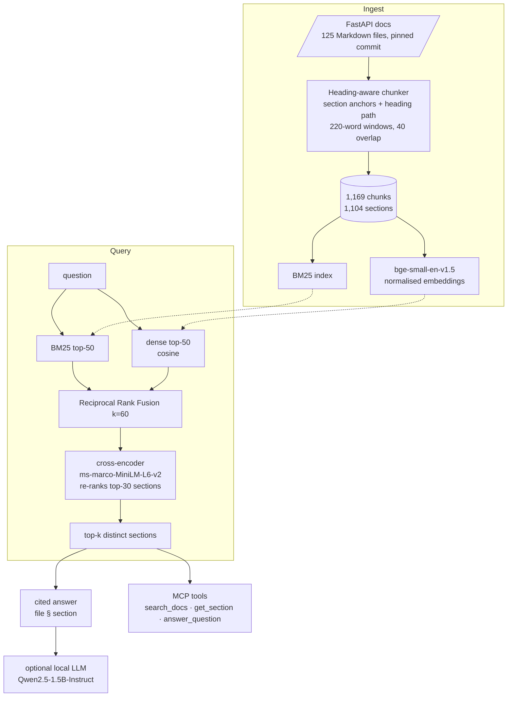

# hybrid-rag-demo

Retrieval-augmented question answering over the **FastAPI documentation** with **hybrid retrieval** — BM25 +
dense embeddings fused with Reciprocal Rank Fusion, then re-ranked by a cross-encoder — answers that **cite file
and section**, a **hand-labeled evaluation set**, and an **MCP server** so Claude (or any MCP client) can use it as a
tool. Everything runs locally with small open models.

## Problem

Keyword search misses paraphrases ("let my React app call the API" → *CORS*), while embeddings miss exact
identifiers (`response_model_exclude_unset`). Production RAG systems combine both and re-rank, but the choice
should be justified with numbers on your own corpus, not by default. This repo builds the full pipeline and measures
each stage on 69 real questions.

## Architecture



* **Chunking** (`chunking.py`): split on Markdown headings outside code fences, keep FastAPI's explicit
  `{ #anchor }` ids so every chunk maps to a linkable `file#anchor`, carry the heading path into the chunk text,
  drop `{* include *}` directives, normalise `/// tip` admonitions, and window long sections. Release notes,
  API reference stubs and community pages are excluded.
* **Retrieval** (`retrieval.py`): four modes — `bm25`, `dense`, `hybrid` (RRF) and `hybrid_rerank`. Results are
  de-duplicated to distinct sections so *k* means *k* different citations.
* **Answers** (`answer.py`): numbered sources rendered as `[n] file § Heading > Subheading`. With a generator,
  the model is instructed to cite `[n]`, and cited numbers are parsed and checked against the sources
  (out-of-range citations are flagged). Without a generator it returns an extractive answer from the top section.
* **MCP server** (`mcp_server.py`): built on the official Python SDK (`mcp` 2.x, `MCPServer`), with
  pydantic-validated inputs and structured outputs.

## Evaluation set

`data/gold.jsonl` contains **69 questions written by hand** from the documentation, phrased the way a developer
would ask (e.g. *"My JavaScript frontend on another domain cannot call my API. How do I allow it?"*), each
labeled with the single section that answers it. `scripts/build_gold.py` holds the questions in readable form and
resolves each `(file, heading)` label to its anchor in the pinned corpus, failing loudly if a heading moves.

Metrics are computed at the **section** level: Hit@k = share of questions whose labeled section is among the top
*k* distinct sections; MRR@10 = mean reciprocal rank of the labeled section (0 if not in the top 10).

## Results

All numbers below come from `hybrid-rag --device cpu eval` on an AMD Ryzen 7 5800X (CPU only), Windows 11,
Python 3.12, sentence-transformers 6.2, FastAPI docs at commit `ba47d6d`. Index build (chunking + embedding 1,169
chunks on CPU): **71 s**. Full evaluation of the five configurations: **8 min 20 s**, almost all of it re-ranking.

| Retriever | n | Hit@1 | Hit@3 | Hit@5 | Hit@10 | MRR@10 | File Hit@5 | Mean latency ms | p95 ms |
|---|---:|---:|---:|---:|---:|---:|---:|---:|---:|
| bm25 | 69 | 0.304 | 0.594 | 0.623 | 0.739 | 0.469 | 0.942 | 1.6 | 2.3 |
| dense | 69 | 0.420 | 0.681 | 0.754 | 0.855 | 0.560 | 0.957 | 12.1 | 13.8 |
| hybrid | 69 | 0.435 | 0.696 | 0.710 | 0.812 | 0.573 | 0.957 | 14.3 | 16.5 |
| hybrid_rerank (ms-marco-MiniLM-L6-v2) | 69 | 0.435 | 0.609 | 0.739 | 0.870 | 0.560 | 0.986 | 1043.7 | 1294.5 |
| hybrid_rerank (bge-reranker-base) | 69 | 0.406 | 0.681 | 0.725 | 0.870 | 0.560 | 0.957 | 5851.6 | 6693.3 |

Raw per-question ranks: `results/retrieval_eval.json`.

**What the numbers say**

* **Dense beats BM25 clearly** on paraphrased developer questions: Hit@5 0.754 vs. 0.623, MRR 0.560 vs. 0.469. In
  11 questions BM25 missed the section in its top 5 and dense found it; the reverse happened twice.
* **Hybrid (RRF) gives the best MRR (0.573) and Hit@1/Hit@3**, i.e. it puts the right section first most often,
  at ~14 ms per query. It is slightly worse than dense alone at Hit@5/10, because fusing with a weaker ranker can
  push a dense hit down.
* **Re-ranking did not pay off on this corpus.** Both cross-encoders raise Hit@10 to 0.870 and the MiniLM
  re-ranker gets the best file-level Hit@5 (0.986), but neither improves MRR, and they cost 70× (MiniLM) to
  400× (bge-reranker-base) the latency on CPU. Comparing hybrid vs. hybrid + MiniLM per question, re-ranking
  improved the rank of the labeled section 16 times and worsened it 16 times. The MS MARCO-trained re-rankers do
  not know that a FastAPI section titled *"Use a `Response` parameter"* answers a question about cookies.
* **Most misses are near-misses.** File-level Hit@5 is 0.94–0.99 for every method. Of the 7 questions that no
  method ranked in the top 10, 5 got other sections of the labeled page in hybrid's top 3 (e.g. the 404 question
  retrieved *Handling Errors > The resulting response* instead of *Use `HTTPException`*), and the other 2 got pages
  covering the same topic (static files are also served in *Custom Docs UI Static Assets*). Section-level,
  single-label scoring is strict.

**Decision for this corpus:** use `hybrid` without re-ranking by default; it is the best-ranked first result at
interactive latency. Re-ranking is kept as an option and should be re-evaluated with a domain-tuned re-ranker or on
GPU.

### Example answers

`results/example_answers.md` holds five real answers generated with `Qwen/Qwen2.5-1.5B-Instruct` on top of
`hybrid_rerank` retrieval (k = 4), including an out-of-scope question (Kubernetes autoscaling). They show the
limits of a 1.5B generator honestly: it found the right sources for CORS, lifespan events,
`response_model_exclude_unset` and WSGI mounting, but **it never emitted the `[n]` markers it was asked for**
(the parser reports `Cited in answer: none` for all five), and it invented APIs such as `app.frontend()` and
`app.add_lifespan_event()`. The citations users see therefore come from retrieval, not from the model; the
MCP tool `answer_question` deliberately hands the numbered context to the calling model (e.g. Claude) instead.

## Run it

```bash
pip install -e ".[models,generate,dev]"
bash scripts/fetch_docs.sh                       # sparse-clones FastAPI docs at the pinned commit into docs-src/
hybrid-rag --device cpu build --docs docs-src/docs/en/docs
hybrid-rag --device cpu eval --rerankers cross-encoder/ms-marco-MiniLM-L6-v2 BAAI/bge-reranker-base
hybrid-rag --device cpu search "how do I allow my frontend to call the API" --mode hybrid_rerank
hybrid-rag ask "How do I run code at startup?" --generator Qwen/Qwen2.5-1.5B-Instruct
```

### As an MCP server

```bash
hybrid-rag-mcp --index /absolute/path/to/hybrid-rag-demo/index --device cpu
```

Claude Code:

```bash
claude mcp add fastapi-docs -- hybrid-rag-mcp --index /absolute/path/to/hybrid-rag-demo/index --device cpu
```

Claude Desktop (`claude_desktop_config.json`, see [`examples/`](examples/claude_desktop_config.json)):

```json
{
  "mcpServers": {
    "fastapi-docs": {
      "command": "/absolute/path/to/.venv/bin/hybrid-rag-mcp",
      "args": ["--index", "/absolute/path/to/hybrid-rag-demo/index", "--device", "cpu"]
    }
  }
}
```

| Tool | Purpose |
|---|---|
| `search_docs(query, k=5, mode="hybrid_rerank")` | ranked sections with `[n] file § section` citations and text |
| `get_section(file, anchor)` | full text of one section |
| `answer_question(question, k=4)` | numbered, citation-ready context and instructions for the calling model |

## Tests

```bash
pytest -q
```

24 tests with deterministic fakes (hashing encoder, token-overlap re-ranker) so CI needs no model downloads:
chunking edge cases, BM25, RRF, every retrieval mode, metrics, citation parsing, and the MCP server end to end
through the SDK's in-process client (tool listing, structured results, validation errors, unknown sections).
CI runs ruff, mypy (strict) and pytest on Python 3.10 and 3.12.

## Limitations

* One labeled section per question. Some questions are also answered, partly, by other sections, so the metrics
  are strict lower bounds.
* The questions were written by the same person who built the system, after reading the docs. They avoid copying
  headings, but they are not real user logs.
* 69 questions: differences of a few points between modes are within noise.
* Latency is CPU-only (no GPU) on a desktop machine, single query at a time, models already loaded. Cross-encoder
  latency would drop sharply on a GPU; it was not measured there.
* Code samples referenced by `{* ... *}` includes are not in the Markdown, so questions answerable only from code
  are out of scope.
* Generated answers are shown as examples, not scored; faithfulness evaluation is future work. The 1.5B local
  generator does not follow the citation instruction and hallucinates APIs.

## License

MIT — see [LICENSE](LICENSE). FastAPI documentation © Sebastián Ramírez, MIT. bge-small-en-v1.5 (MIT) and
ms-marco-MiniLM-L6-v2 (Apache-2.0) are downloaded from Hugging Face at runtime.
